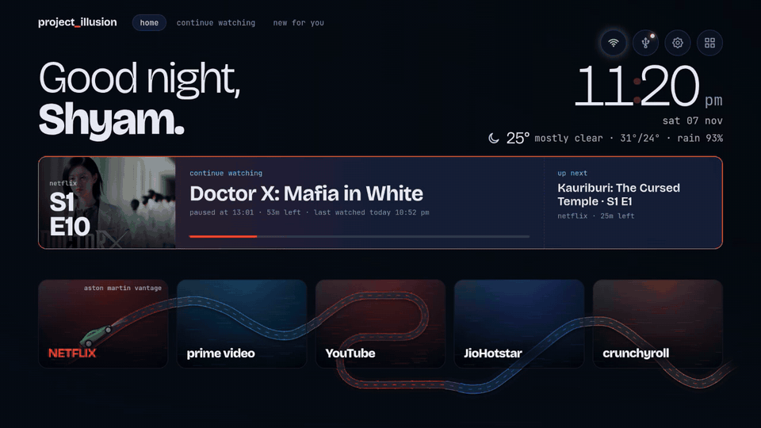
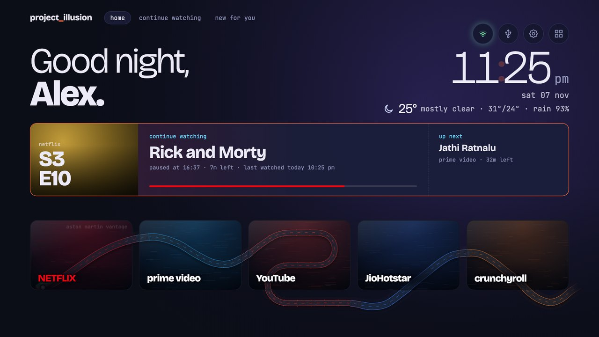
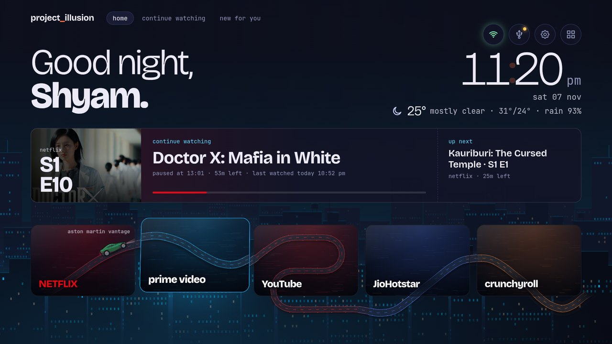
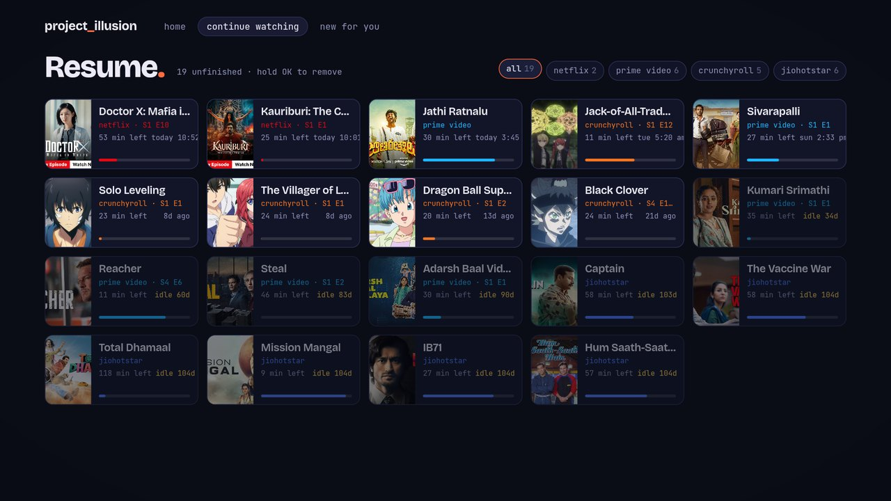
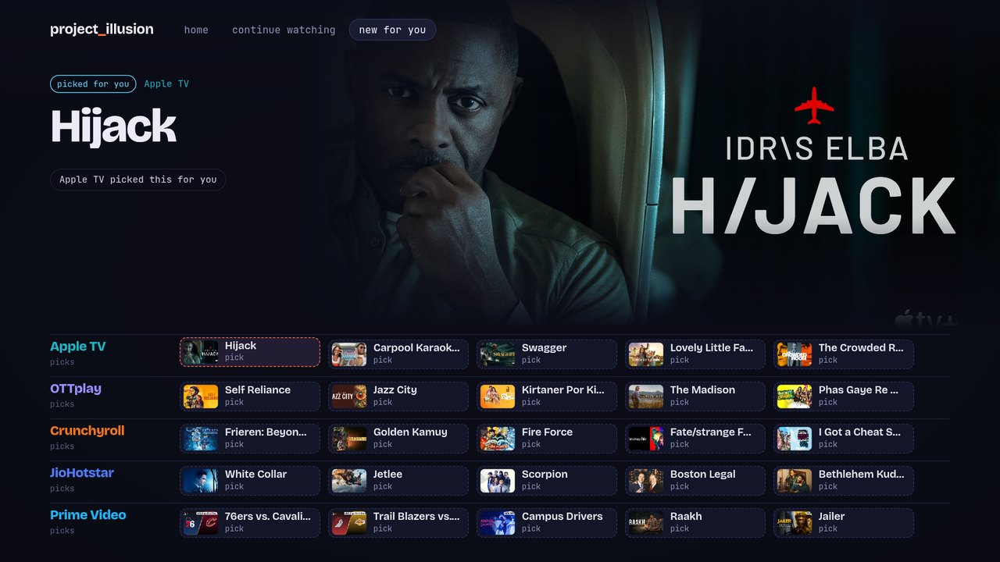
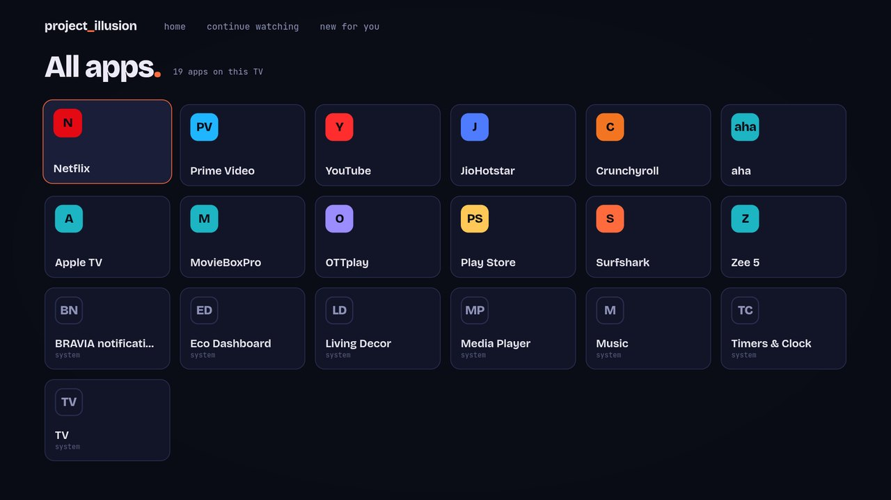
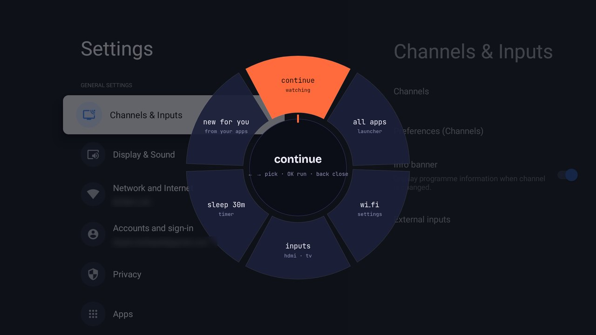

# Project Illusion

**A custom Home screen for Android TV and Google TV: what you were watching, what's new, five apps on a
night road, and a dial to jump anywhere. No ads, no sponsored rows.** Installed over Wi‑Fi from your
computer, with Claude Code doing the work. A spin-off of
[CleanYourTV](#project-illusion-and-cleanyourtv).

<p align="center"></p>
<p align="center"><sub>The Home screen on a Sony BRAVIA. <a href="docs/home.mp4">Watch it as a video</a>.</sub></p>

## What you get

**Pick up where you left off**
- The last show you paused, with its poster, how far you got and what's up next.
- Press OK and it resumes in its app.
- A **Continue watching** page lists everything unfinished across your apps, with a filter for each app.

**Find something new**
- **New for you** lays out new episodes and picks from your apps on a week guide.
- A big spotlight shows the one you're on, with why it's there.

**Your apps, on a night road**
- Three to five apps sit as windows in the dock.
- A cartoon sports car drifts along a winding road through them and turns round on the hairpins.
- Move onto an app and its city rises behind the whole screen in its colour. Press OK to open the app.

**Made for you**
- A greeting with your name, a 12-hour clock with the date, and live weather for your city (°C or °F).
- The *project_illusion* name at the top left is optional; without it the tabs start at the edge.

**Jump anywhere, from inside any app (hold OK)**
- See the section below.

**Light on the TV**
- A small launcher: under 300 KB, with no app libraries, and nothing on your TV uninstalled.
- On a slow TV it notices and switches off the heavier effects by itself.

<table>
  <tr>
    <td width="50%"><br><sub><b>Home.</b> Continue watching on top, your apps below.</sub></td>
    <td width="50%"><br><sub><b>Focus an app.</b> Its city fills the room behind the dock.</sub></td>
  </tr>
  <tr>
    <td><br><sub><b>Continue watching.</b> Everything unfinished, by app.</sub></td>
    <td><br><sub><b>New for you.</b> New episodes and picks on a week guide.</sub></td>
  </tr>
  <tr>
    <td><br><sub><b>All apps.</b> From the grid icon at the top right.</sub></td>
    <td></td>
  </tr>
</table>

## Holding OK: the dial

**Hold OK works inside apps, not on the Home screen.** When you're in an app, say in the middle of a
film on Netflix, hold the OK button on the remote for about half a second. A round dial opens over the
picture:

<p align="center"></p>

- **continue watching**: back to the list of everything unfinished
- **all apps**
- **wi‑fi** settings
- **inputs**: HDMI and other sources
- **sleep 30m**: the screen turns off in 30 minutes
- **new for you**

Move with left and right, press OK to pick, and press Back to close it and carry on watching. A short
press of OK still does what it always did in the app (pause, play, select).

On the Home screen itself, use the tabs at the top and the icons at the top right instead.

## Install

Open this folder in [Claude Code](https://claude.com/claude-code) and say **"install Project Illusion
on my TV"**. Claude follows [CLAUDE.md](CLAUDE.md):

1. It checks your computer has what it needs.
2. It walks you through switching on developer mode on the TV.
3. It finds the TV on your Wi‑Fi.
4. It asks your name, your city and which apps you want.
5. It builds the launcher and installs it.

The TV goes straight from its own Home to Project Illusion. To do it by hand, follow the same file.

**You need:**
- **An Android TV or Google TV:** Android 8 or newer, on the same Wi‑Fi as your computer.
- **A computer** (macOS, Linux, or Windows with Git Bash) with JDK 17 or newer, the Android SDK and
  Python 3. Claude can install what's missing, after asking.

Tested on a Sony BRAVIA 4K VH21 (Android 12). Other TVs should work. See "On a different TV" in
`CLAUDE.md` for what changes.

## Going back to your TV's own Home

Nothing is removed from your TV, so you can always go back. Its own Home app is only switched off, and
is switched on again here. Easiest: open this folder in Claude Code and say **"put my TV back to its
own Home"**. By hand, from this folder:

```bash
export TV_HOST=<your TV's IP address>
tools/tv 'pm enable --user 0 com.google.android.apps.tv.launcherx; pm uninstall com.projectillusion.home'
tools/tv 'cmd package set-home-activity --user 0 $(cmd package resolve-activity --brief -a android.intent.action.MAIN -c android.intent.category.HOME com.google.android.apps.tv.launcherx | tail -1)'
```

1. The first command switches the TV's own Home back on and removes Project Illusion.
2. The second makes the TV's own Home the default again. Press Home on the remote to check.

`com.google.android.apps.tv.launcherx` is Google TV's Home. On an older Android TV it is
`com.google.android.tvlauncher`; the install printed yours as "Stock launcher: …".

Removing Project Illusion deletes its own list of what you were watching. Your apps keep their own
progress, and what they share with the TV comes back if you install it again.

To keep Project Illusion but undo your name, city and dock choices, run
`TV_HOST=<ip> tools/theme.sh --reset`.

## Project Illusion and CleanYourTV

Project Illusion grew out of [CleanYourTV](https://github.com/Gathin23/cleanyourtv), Gathin's open-source
project for taking the ads and clutter off Android TVs over Wi‑Fi. CleanYourTV showed that a TV's Home
can be swapped from a computer with nothing but ADB, and that Claude Code can do the whole job.

Project Illusion started as a theme for CleanYourTV's launcher. It is now a separate, smaller launcher
with one designed Home:

| | CleanYourTV | Project Illusion |
|---|---|---|
| What it's for | Removing ads and bloat, and a clean, configurable Home | One designed Home: Continue watching, New for you, the night-drive dock, the dial |
| Changes to your TV | Switches off the TV maker's ad and tracking apps from a list per model | Switches off only the TV's own Home app; nothing else |
| Launcher | `com.gathin.tvhome`: many layouts, themes and languages | `com.projectillusion.home`: under 300 KB, one Home page |
| Code | The original | Reuses CleanYourTV's ADB tools (`tools/tv.py`, `tools/b64push.py`) and Continue watching store, under its MIT licence; the rest is new |

**Using both.** To clear the ads and bloat too, use CleanYourTV's debloat lists and scripts for your
TV model, then install Project Illusion as the Home. Install only one of the two launchers, because
both want to be the TV's Home.

## What's in this repository

| Folder | What's in it |
|---|---|
| `launcher/` | The Android launcher. The Home page is `app/src/main/assets/home/`; the Java beside it (`HomeActivity` and a few helpers) feeds it what the TV knows. |
| `themes/project-illusion/` | Your settings: name, the project_illusion label, weather place, dock apps. |
| `tools/` | Talking to the TV over Wi‑Fi (`tv`, `find_tv.py`) and pushing a theme (`theme.sh`). |
| `design/nightdrive/` | The source the night drive is generated from. |
| `docs/` | The screenshots and recording above. |

## Credits

- [CleanYourTV](https://github.com/Gathin23/cleanyourtv) by Gathin: the inspiration, and the source of the
  ADB tools and the Continue watching store (MIT licence, see `LICENSE-CleanYourTV`).
- Fonts: Bricolage Grotesque, Instrument Sans and JetBrains Mono (SIL OFL,
  `launcher/FONT-LICENSE-OFL.txt`).

Car pictures: Wikimedia Commons photos, backgrounds removed, then illustrated and repainted.
- Mustang GT: Greg Gjerdingen from Willmar, USA (CC BY 2.0).
- 911 GT3 RS: Sokrates 399 (CC BY 4.0).
- GT-R Nismo: Norbert Aepli, Switzerland (User:Noebu) (CC BY 3.0).
- M8 Competition: Alexandre Prevot from Nancy, France (CC BY-SA 2.0).
- Vantage: Mr.choppers (CC BY-SA 3.0).

The screenshots show show and film posters from the apps on the test TV. They belong to their owners.

## Licence

Project Illusion is under the [Apache License 2.0](LICENSE). The parts from CleanYourTV stay under
their [MIT licence](LICENSE-CleanYourTV), the fonts under the SIL OFL, and the car pictures under
the Creative Commons licences listed above. [NOTICE](NOTICE) sums this up; keep it with any copy
you share.

The licence doesn't cover the name. If you ship a modified version, give it a different name.
